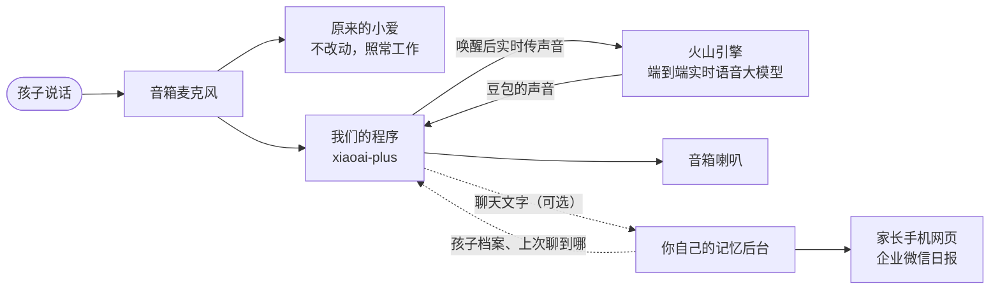

# 原理：小爱音箱是怎么变成豆包的

这篇写给想弄明白原理的人，也写给想在别的设备上照着做的人（和他们的 AI 助手）。具体操作步骤见[搭建指南](搭建指南.md)；想改别的型号，看完这篇再看[移植到其他设备](移植到其他设备.md)。

## 一句话

小爱音箱里面其实是一台小型 Linux 电脑。我们刷机给它开一个只认自己钥匙的远程登录（SSH），把自己的程序放进去，开机自动运行。这个程序和原来的小爱共用麦克风和喇叭：听到"豆包豆包"，就把声音实时送到火山引擎的豆包语音大模型，再把豆包的回答放出来。

下面按顺序讲五块：拿到控制权、和小爱共处、本地听唤醒词、实时对话、认人和记忆。

## 1. 拿到音箱的控制权（刷机）

- 小米智能音箱 Pro（型号 OH2P）用的是晶晨（Amlogic）芯片。这类芯片有个刷机模式：通电后的一瞬间，如果 USB 连着电脑，电脑就能读写它的存储。这个窗口只有约 1.6 秒，所以 05 脚本在电脑这边一直等着抓，人只管拔插电源。
- 存储里有两套系统（boot0/system0 和 boot1/system1），音箱用其中一套启动。我们只改正在用的那一套 system 分区，也就是只读的系统分区（SquashFS 格式）。
- 补丁是在官方固件上做的，只改了几处：
  1. 打开 SSH 远程登录（Dropbear），关掉密码登录，只认你电脑上生成的那把钥匙；
  2. 放进这把钥匙的公钥；
  3. 开机脚本 `rc.local` 加几行：如果 `/data/xiaoai-plus/boot.sh` 存在，就运行它。
- 小爱自己的程序一个字节都没改。刷完以后，只要不装我们的程序，音箱就和原来一样。
- 我们的程序装在 `/data/xiaoai-plus`。`/data` 是可写的数据分区，刷机不动它。
- **为什么只支持固件 1.62.2**：补丁是在这个版本的官方固件上做的，脚本会逐个核对文件的哈希，对不上就停。换了版本，补丁要重新做，改的还是这几处。
- **为什么别接受小米升级**：升级会整个换掉系统分区，补丁跟着没了，豆包也就不会启动了；小爱不受影响。

刷机这一步的底层方法来自 [open-xiaoai](https://github.com/idootop/open-xiaoai) 和 [xiaoai-plus](https://github.com/kslr/xiaoai-plus)。我们把它改成了一步一步可核对的脚本：每步先打印要做什么，写之前两遍读出备份，写之后读回比对。

## 2. 和原来的小爱共处

我们没有替换小爱，而是在旁边"搭便车"：

- **麦克风**：音箱系统里有一个能和小爱同时读的录音设备（OH2P 上叫 `noop`，32 位多声道，我们取波束成形后的那一路）。程序用系统自带的 `arecord` 读它，小爱照样能听到"小爱同学"。
- **喇叭**：用系统自带的 `aplay` 放声音，走系统默认输出，和小爱共用一个音量控件（`mysoftvol`）。所以小爱调了音量，豆包跟着变；对豆包说"大声点"，程序直接在本地调这个控件。
- **让路**：程序盯着系统日志，一看到小爱被唤醒，豆包就停下，让给小爱。豆包开口前，用小爱自带的 `mphelper` 暂停正在放的音乐。
- **借嗓子**：豆包连不上时（比如额度用完、网络断了），用小爱自带的语音合成（`/usr/sbin/tts_play.sh`）说"豆包连不上了，请告诉爸爸妈妈"。
- **守护**：开机后 `boot.sh` 先等网络通，再启动程序；程序退出就自动重启，30 分钟内崩溃 5 次就不再重启，免得拖垮音箱。

## 3. 在音箱本地听"豆包豆包"

- 唤醒词在音箱本地识别，用的是开源的 [sherpa-onnx](https://github.com/k2-fsa/sherpa-onnx) 关键词识别（一个很小的 zipformer 模型）。它只听两类词："豆包豆包"，和 1 个结束词（退出）。词表在 [keywords/](../xiaoai-plus/keywords/)。
- **没喊"豆包豆包"之前，声音不会离开音箱。**
- 待机时一直在听，大约占一个 CPU 核的八成。
- 针对孩子调过的地方：孩子声音高、发音含糊，我们调低了唤醒门槛，并给唤醒识别单独加了自动增益（只影响本地识别，不影响传给豆包的声音）。
- 一个坑：sherpa-onnx 默认让空闲线程原地空转等活，在这台音箱上待机 CPU 会从约 80% 涨到约 270%。我们打了补丁把它关掉（见 [toolchain/sherpa-kws-observability.patch](../xiaoai-plus/toolchain/sherpa-kws-observability.patch)）。

## 4. 和豆包实时对话

- 唤醒后，程序用 WebSocket 连火山引擎的"端到端实时语音大模型"（O2 版本）。它和"先转成文字、再让大模型回答、再合成语音"的老办法不同：听、想、说由一个模型完成，所以反应快，语气也自然。
- 上行是 16kHz 单声道的原始音频，每 20 毫秒一包；下行是 24kHz 的声音，边收边放。
- 一次唤醒就是一个会话，可以连续聊很多轮。30 秒没人说话自动结束；说结束词立刻结束。
- **半双工**：豆包说话时，我们不把麦克风的声音传上去。这台音箱上没有能用的回声消除，传上去豆包会听到自己说话。这段时间程序只在本地听结束词，所以孩子随时可以说"退出"。
- **等孩子说完**：孩子说英语常常停下来想词。程序看云端实时返回的文字，判断这句话说完没有：像说完了，停 1.5 秒就让豆包回答；像没说完（比如 "I want..."），最多等 4.5 秒。云端自己的判断（6 秒）只作兜底。
- **性格和规矩写在提示词里**，见 [xiaoai-plus/src/memory/core.cpp](../xiaoai-plus/src/memory/core.cpp) 的 `Safety` 函数：
  - 只说英语，用简单的词；
  - 孩子说错了不说"错"，在回答里把对的说法自然说一遍；
  - 六个小游戏：讲故事、猜谜、敲门笑话、Simon says、"笨豆包"、猜动物；
  - 安全规则：不打听住址学校电话，孩子难过或有危险就让他找爸爸妈妈。

  想换个角色，比如中文故事大王，改这段文字、重新编译就行。

## 5. 认人和记忆（可选，需要你自己的服务器）

不搭后台也能用：豆包照样是英语玩伴，只是不知道是谁在说话，也不记得上次聊了什么。搭了后台，多出下面这些：

- **认人**：每次唤醒，豆包先问 "Hi! Are you Amy or Ben? Or a grown-up?"（名字来自配置）。孩子的回答先在音箱上按规则匹配名字，拿不准再交给后台，用火山方舟的一个小模型判断。还听不清就再问一次，再不行就当"客人"聊，不用任何人的记忆。认错了，孩子说一下自己的名字就能改。
- **续聊**：认出是谁以后，程序把这个孩子的档案（年级、兴趣）、最近几次的小结和"续聊卡"放进提示词。所以豆包会说："上次我们聊到了恐龙，接着聊还是换个新的？"
- **离线也能认**：音箱会从后台拉一份档案快照存在本地，后台临时连不上也能用（缓存最多用 24 小时）。
- **聊完以后**：音箱把这次的文字记录传给后台。后台用方舟小模型写小结、挑出孩子说过的英文单词，生成下次的续聊卡。
- **家长页**：在手机网页上看每个孩子每天聊了什么、说了哪些词，也可以删掉。删除以后，等音箱同步完，豆包就不会再提。还可以每天晚上把概况发到企业微信群。
- **隐私**：
  - 声音只在豆包会话期间直连火山；
  - 聊天文字先在音箱上暂存，再上传到你自己的服务器，作者看不到；服务器上的数据库加密保存；
  - 放进提示词之前，会先把电话、地址、学校这类内容替换掉。

后台代码在 [server/](../server/)（Python + SQLite），部署见 [server/README.md](../server/README.md)。

## 哪些是这台音箱特有的

| 部分 | 换一台设备时 |
|---|---|
| 拿到控制权（第 1 节） | 每种设备都不一样，也是最难的一步。有的设备根本没有公开的办法 |
| 录音、放音、音量、给小爱让路（第 2 节） | 要按新设备的系统重新摸清楚，改几处设备名和命令 |
| 本地唤醒词（第 3 节） | 程序能直接用，门槛要按新麦克风重新调 |
| 实时对话、提示词（第 4 节） | 基本通用：设备能联网、能录音、能放音就行 |
| 认人、记忆、家长页（第 5 节） | 完全通用，和音箱无关 |

详细的移植方法见[移植到其他设备](移植到其他设备.md)。

## 这个项目是怎么做出来的

作者不会写代码，整个项目是和 AI 编程助手一起做的。分工是这样：

- Claude Code 负责"想"：读代码、查问题出在哪、定方案。
- Codex 负责"动手"：改代码、跑测试、操作音箱和服务器。

几条一直守着的规矩：

- 每次改动先在电脑上测试，唤醒相关的改动还要用录好的声音回放一遍，过了才装到音箱上。
- 装之前先在音箱上留一份回退，出了问题一条命令就能换回去。
- 孩子正在用的时候不动音箱。
- 钥匙和密码不进聊天记录，也不进代码仓库。

这个仓库里的 [AGENTS.md](../AGENTS.md) 就是写给你的 AI 助手看的。你让它打开这个项目，它就会照着上面的规矩，一步一步带你做。
